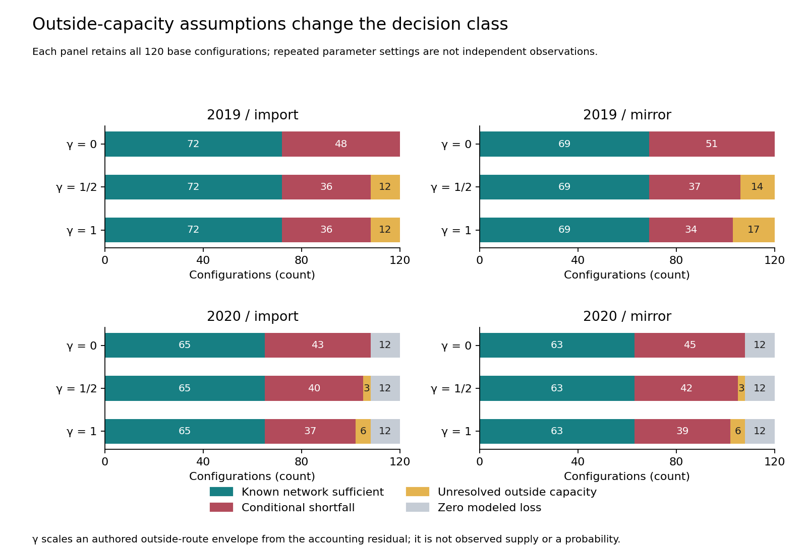

# Return a range when supplier data are incomplete

A planner should not turn missing supplier information into a single replacement promise. This historical wheat-network exercise returns conditional coverage/unmet intervals and identifies when outside-supplier availability determines the answer.

**Finding:** under the full authored outside-capacity envelope, 41 of 456 positive-loss configurations remain unresolved. Known-only separate-country calculations overclaim a shared supplier pool in four mirror-basis configurations and none of the import-basis configurations. The largest known-only gap is 454,708.41 tonnes. These are parameter-grid results, not observed shipment losses or probabilities.

## Practical use

Require explicit supplier-volume, routing and outside-capacity assumptions before returning a replacement estimate. Return a range when those assumptions are incomplete, and obtain supplier-specific evidence before promising deliveries. A mathematically feasible flow does not establish available cargo, grain compatibility, freight access or contracts.

The model preserves all 480 configurations, three outside-envelope endpoints each, every allocation/slack and 11,520 cut-subset certificates. The outside envelope scales a signed national-minus-common-import accounting residual; that residual is **not measured spare supply**. Without a finite outside cap, the same known-network assumptions give the wider upper bound of total modeled demand.

## Run and inspect

~~~powershell
python -m pip install -r requirements.txt
python src/bounds_replay.py --out ../bounds-replay
python src/bounds_check_exercise.py
python src/verify_canonical_git.py
~~~

Use a new output directory. The [implementation exercise](EXERCISE.md) requires a saved historical scenario and explicit outside envelope; eight requests produce two qualified intervals, two abstentions and four rejections.

- [Six-page manuscript](paper/manuscript.pdf), [complete summary](results/bounds/summary.json), [2019 endpoint accounts](results/bounds/endpoints_2019.csv) and [2020 endpoint accounts](results/bounds/endpoints_2020.csv). Every flow, importer/supplier account and cut is retained beside them.
- [Source-informed protocol](BOUNDS_PROTOCOL.md), [signed source/support accounts](data/bounds_support.csv), [all bilateral exclusions](data/bounds_pair_support.csv) and [64 actual frozen dependencies](BOUNDS_FREEZE.json). Development freeze f9d4de7a01a2818461df34c9767395d86d9d3654 precedes later-year summaries. Both years' source values were already visible; this is not predictive validation.
- Four native captures/179 requested positions/4,706 independent source conditions. Separate independent SQLite/Fraction verification passes 145,694 conditions per year, including every finite-network constraint and exact minimum cut. All 56 fixture methods and 37 summary/exercise conditions pass.
- Full-history [CPython 3.10.11](results/bounds/reproduction_cpython310.json) and [3.12.14](results/bounds/reproduction_cpython312.json) replays reproduce 14 primary files byte for byte, preserving 23 source-directory files each. [Figure checks](figures/verification.json): 64 bound artists/256 actual SVG corners/719 conditions. [Paper checks](paper/verification.json): 107 used bindings, all six source/twelve classification/four overclaim rows and 469 conditions; all six rendered pages inspected.

## Original failure and limits

The original UN attempt and separate FAO 80% coverage gate remain failed. Morocco 2020 has 79.478498% common-import support. The original coverage-gated network study and [Issue #1](https://github.com/S3R3Bii/wheat-supplier-stress/issues/1) remain unexecuted/open. This release completes the distinct conditional-bounds question in [Issue #3](https://github.com/S3R3Bii/wheat-supplier-stress/issues/3). No country, source value, threshold or original gate is changed; all 39 historical source/code/test files are byte preserved in [the history guard](HISTORY_SOURCE_HOLD.json).

Three importers, ten origins, compiled 2019/2020 grain quantities and authored capacity assumptions do not establish current food risk, actual spare volume, delivery feasibility, nutrition, prices, political priority, causal benefit, forecast accuracy, adoption or savings. Twenty-four base configurations have zero loss inside the restricted support; this does not prove zero physical exposure. A/I source flags remain visible; mirrors are not independent ground truth. No new max-flow method or exhaustive scientific-priority claim. Not peer reviewed.

Sources: [FAO/FAOSTAT detailed trade](https://www.fao.org/faostat/en/#data/TM/metadata) and [national trade totals](https://www.fao.org/faostat/en/#data/TCL/metadata), with UNSD/Eurostat upstream restrictions described in [the source plan](FAO_SOURCE_PLAN.md). Unit conversion, support filtering and scenarios are author modifications; no publisher endorsement. Minimal attributed factual subset only; code licensing does not grant unrestricted rights in source data. Native exports, expressive source material, contacts, credentials and formal-publication projects including Azure optimization remain private. Existing Git authorship history is preserved; new release checkpoints use the account's noreply identity.
